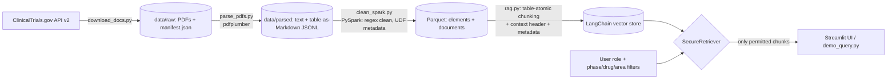
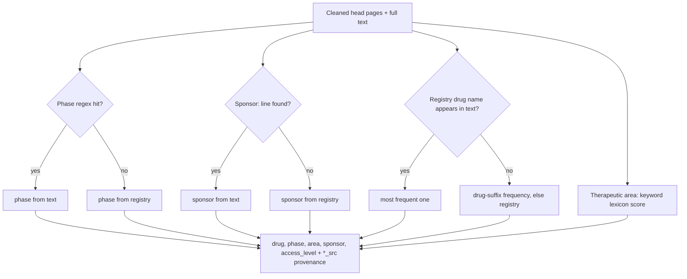
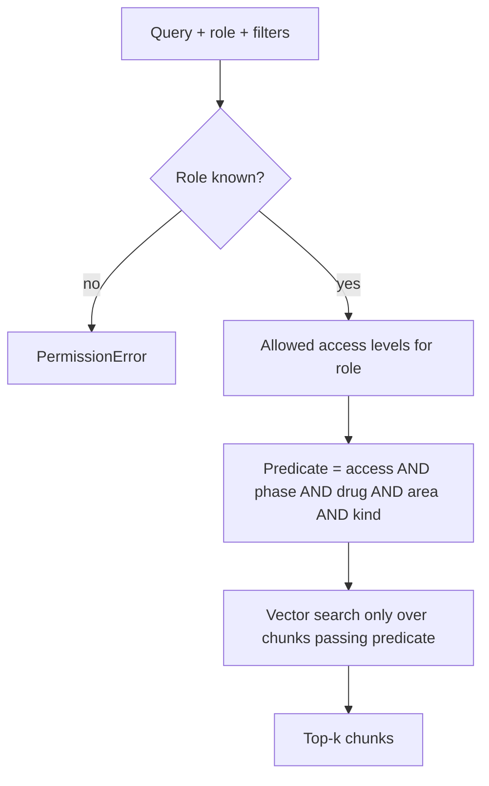
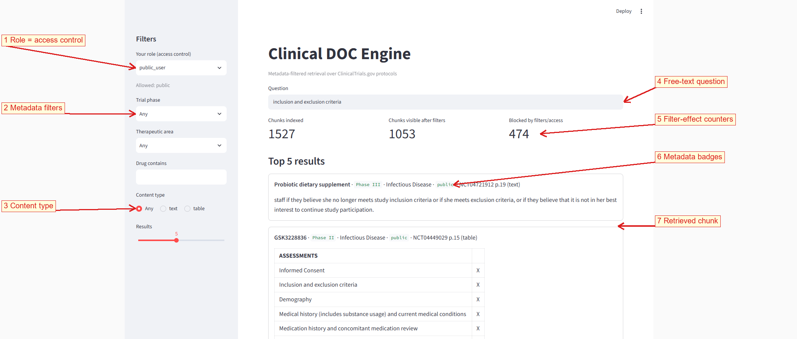
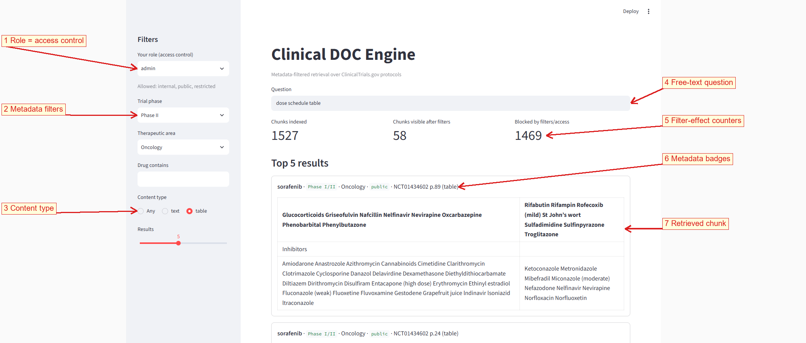

# Clinical DOC Engine

PDF protocols from ClinicalTrials.gov → structured Parquet → metadata-filtered LangChain retrieval.

## Architecture



### Metadata extraction (per document)



### Query-time enforcement



## Demo UI

Run `streamlit run src/app.py` (regenerate images with `python scripts/make_screenshots.py`).

**1. Public user, no filters** – only `public` documents are visible; restricted/internal chunks are blocked.



**2. Admin, Phase II + Oncology + tables only** – the counters show how far the filters narrow the index.



| # | UI element | What it does |
|---|---|---|
| 1 | Role selector | Sets the mandatory access filter (`public_user`, `employee`, `admin`); cannot be bypassed by the query |
| 2 | Phase / Therapeutic area / Drug | Optional metadata filters AND-ed with the role filter |
| 3 | Content type | Restrict to prose or to tables |
| 4 | Question box | Free-text semantic query |
| 5 | Counters | Chunks indexed vs visible vs blocked – shows the filter is enforced before ranking |
| 6 | Badges | Drug · phase · area · access level · source doc/page of each hit |
| 7 | Result card | Chunk text; tables render as real tables |

## Pipeline commands

```
python src/download_docs.py --n 8          # 1. fetch public protocol PDFs + registry metadata (data/raw)
python src/parse_pdfs.py                   # 2. pdfplumber: prose + tables-as-Markdown (data/parsed)
python src/clean_spark.py                  # 3. PySpark clean + metadata -> data/processed/*.parquet
python src/clean_spark.py --engine pandas  #    same logic without a JVM
python src/demo_query.py                   # 4. filtered retrieval + access-control assertions
```

| File | Role |
|---|---|
| `src/parse_pdfs.py` | Layout-aware parsing; table regions become Markdown, prose is extracted outside table bboxes so cells aren't duplicated |
| `src/meta_extract.py` | Cleaning regexes + extractors for phase, sponsor, drug, therapeutic area (text first, registry fallback; source recorded in `*_src` columns) |
| `src/clean_spark.py` | PySpark job (regexp_replace cleaning, per-doc aggregation, UDF metadata) → `elements.parquet`, `documents.parquet` |
| `src/rag.py` | Table-atomic chunking, context headers, `SecureRetriever` (role-based access filter AND phase/drug/area/kind filters) |
| `data/access_overrides.json` | **Simulated** access levels (all source docs are really public) so the authorization filter can be demonstrated |

Notes
- Spark needs Java 8/11/17 (`JAVA_HOME`); on Windows, native Parquet writes also need `winutils`/Hadoop — the script falls back to Arrow writes. Or run in Google Colab.
- Embeddings are an offline hashing stand-in; set `EMBEDDINGS=openai` and `OPENAI_API_KEY` for real ones.
- Two source PDFs are scanned/short (≈2–7 elements), so their metadata comes mostly from registry fallback. Azure Document Intelligence/OCR would fix that.
- Extractors are heuristic (e.g. Therapeutic Area = keyword lexicon); validate against the registry fields in `data/raw/manifest.json` before relying on them.

